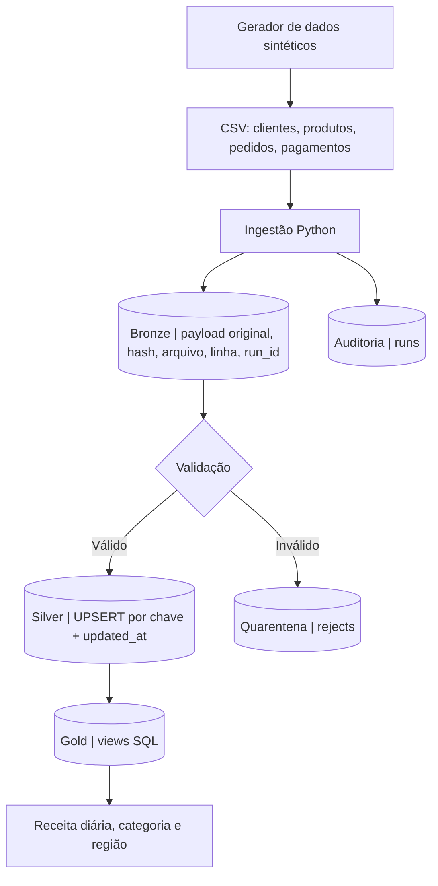

<div align="center">

# ProspectAI | Retail Data Platform

### Engenharia de Dados aplicada a um cenário realista de e-commerce

**Pipeline local de ingestão, qualidade, atualização incremental e indicadores analíticos**


[Visão geral](#visão-geral) · [Arquitetura](#arquitetura) · [Execução](#como-executar) · [Qualidade](#qualidade-e-auditoria) · [Consultas](#consultas-analíticas) · [Limitações](#decisões-técnicas-e-limitações)

</div>

---

## Visão geral

**O problema:** uma operação fictícia de varejo recebe arquivos de clientes, produtos, pedidos e pagamentos. Há atualizações fora de ordem, duplicidades e registros inválidos. A equipe comercial precisa de indicadores de receita que considerem apenas pedidos aprovados e pagamentos confirmados.

**A solução:** pipeline em Python que gera dados sintéticos, registra a ingestão na camada Bronze, valida e consolida registros na Silver e expõe consultas SQL na Gold. Cada execução é auditável e pode ser reprocessada sem duplicar chaves na Silver.

| Dimensão | Cenário padrão |
|:--|--:|
| Clientes sintéticos | 5.000 |
| Produtos sintéticos | 200 |
| Pedidos únicos gerados | 50.000 |
| Pagamentos gerados | 50.000 |
| Linhas de entrada, incluindo casos de qualidade | 105.202 |
| Registros inválidos esperados | 1 |
| Testes automatizados | 4 |

> Os números acima são **esperados para o comando padrão**; não são métricas de produção. Os dados são totalmente fictícios.

## Arquitetura



**Bronze:** registros brutos por execução, com origem, linha, hash e identificador de processamento.

**Silver:** dados tipados e consolidados por chave de negócio. Atualizações antigas não sobrescrevem versões mais recentes.

**Gold:** views analíticas com receita e pedidos por dia, categoria e região. Apenas pedidos `approved` com pagamento `paid` compõem as vendas.

**Auditoria:** a tabela `runs` registra início, fim, status e contagens. Registros inválidos são direcionados a `rejects`.

## Como executar

**Pré-requisito:** Python 3.10 ou superior. Não exige Docker, servidor de banco ou instalação de pacotes externos.

Clone o repositório ou baixe o ZIP e abra o terminal na pasta principal.

**1. Gerar dados sintéticos**

```bash
python -m src.retail generate --rows 50000
```

Arquivos criados em `data/synthetic/`: `customers.csv`, `products.csv`, `orders.csv` e `payments.csv`.

**2. Executar a carga**

```bash
python -m src.retail load
```

O banco SQLite é criado em `output/retail.db`.

Exemplo de resultado para 50 mil pedidos:

```json
{
  "raw": 105202,
  "rejected": 1,
  "accepted": 105201
}
```

`accepted` representa linhas que passaram na validação, **não** a quantidade de registros distintos na Silver.

**3. Executar os testes**

```bash
python -m unittest discover -s tests -v
```

Os testes cobrem carga e qualidade, idempotência, atualização atrasada e rollback em falha estrutural. O workflow `Python tests` também os executa no GitHub Actions.

**4. Experimentar outro volume**

```bash
python -m src.retail generate --rows 100000
python -m src.retail load
```

A segunda execução preserva a Silver e aplica UPSERT por chave. A Bronze mantém os registros de cada execução, inclusive os reprocessados.

## Consultas analíticas

As views Gold podem ser consultadas no SQLite, DBeaver ou via Python.

**Receita por categoria**

```sql
SELECT category, orders, revenue
FROM gold_category_sales
ORDER BY revenue DESC;
```

**Receita por dia**

```sql
SELECT sale_date, orders, revenue
FROM gold_daily_sales
ORDER BY sale_date;
```

**Receita por região**

```sql
SELECT region, orders, revenue
FROM gold_region_sales
ORDER BY revenue DESC;
```

**Auditoria das últimas execuções**

```sql
SELECT run_id, started_at, ended_at, status, raw_count, rejected_count
FROM runs
ORDER BY started_at DESC
LIMIT 10;
```

**Registros rejeitados**

```sql
SELECT entity, line_number, reason, payload
FROM rejects
ORDER BY id DESC;
```

## Qualidade e auditoria

| Controle | Comportamento |
|:--|:--|
| Campos obrigatórios | Rejeita valores ausentes ou vazios |
| Chaves | Rejeita identificadores inválidos |
| Regras de domínio | Valida quantidade, preço, status e datas |
| Atualização fora de ordem | Mantém o maior `updated_at` por chave |
| Reprocessamento | Não duplica registros na Silver |
| Erro de esquema | Interrompe e reverte a transação |
| Rastreabilidade | Preserva payload, hash, arquivo, linha e execução |

## Estrutura do repositório

```text
.github/workflows/
  tests.yml            # Integração contínua
src/
  __init__.py
  retail.py            # Gerador, ingestão, qualidade e carga
tests/
  test_retail.py       # Testes automatizados
.gitignore
README.md
```

Os CSVs gerados e o banco SQLite ficam fora do versionamento, conforme `.gitignore`. Isso permite reproduzir o cenário sem armazenar arquivos volumosos no GitHub.

## Decisões técnicas e limitações

- **SQLite** torna o projeto portátil e executável localmente, sem infraestrutura adicional.
- O incremental é implementado como **UPSERT por chave e timestamp**, não como CDC ou extração de origem por watermark.
- **Bronze é append-only**: reprocessar um arquivo registra novas linhas brutas, enquanto a Silver permanece idempotente.
- A transação protege a carga contra falhas estruturais.
- **Não há verificação de integridade referencial entre todas as fontes nem orquestração agendada** nesta versão.
- O projeto não simula dados reais de clientes nem utiliza informações sensíveis.

## Próxima evolução

O modelo Gold poderá alimentar um **dashboard Power BI de vendas**, demonstrando a integração entre Engenharia de Dados e Business Intelligence.

---

<div align="center">

**ProspectAI** · Engenharia de Dados, BI e Automação

Contato: **prospectai.solucoes@gmail.com**

*Projeto demonstrativo com dados sintéticos, desenvolvido para portfólio técnico.*

</div>
